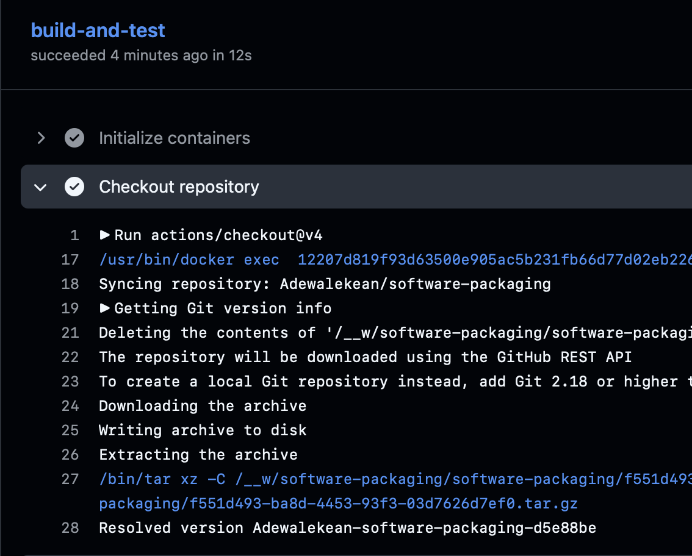
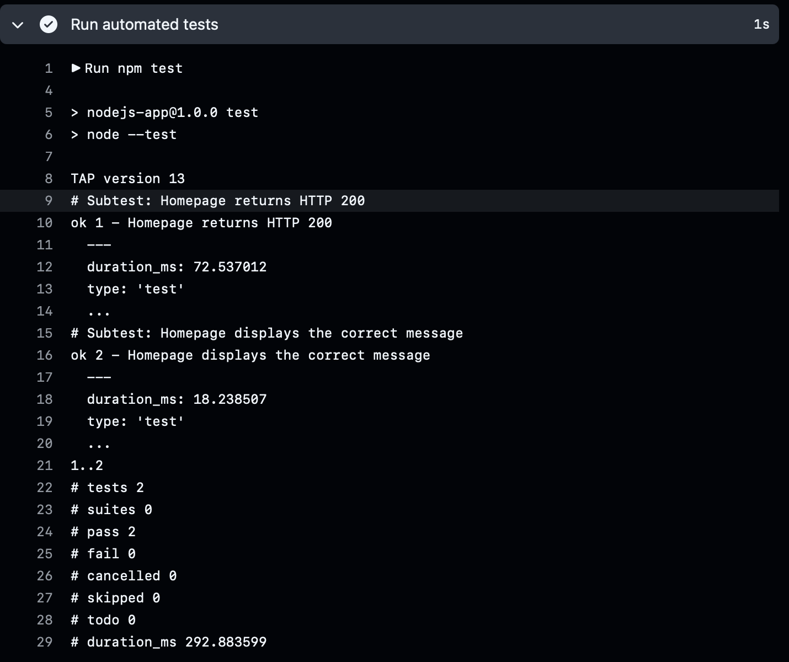
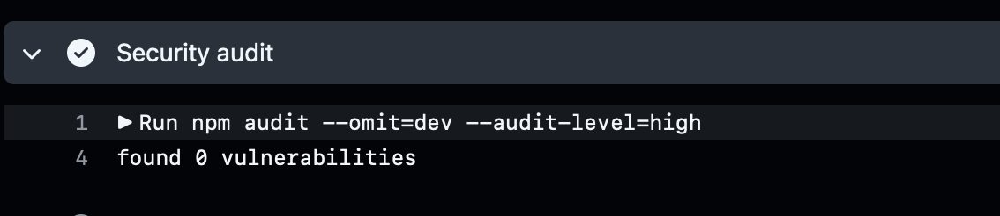
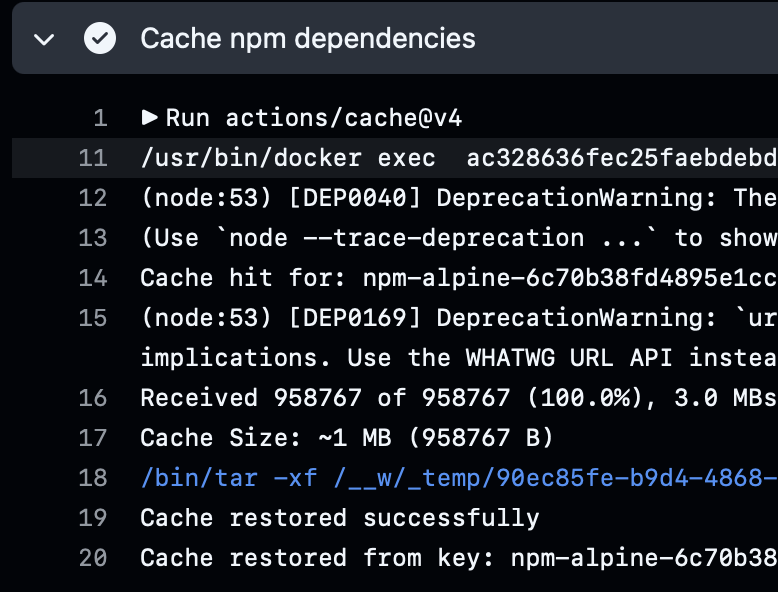
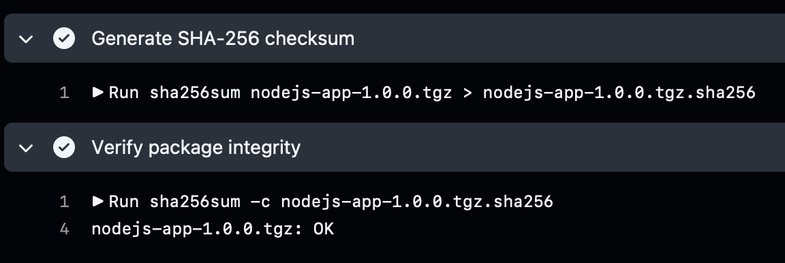
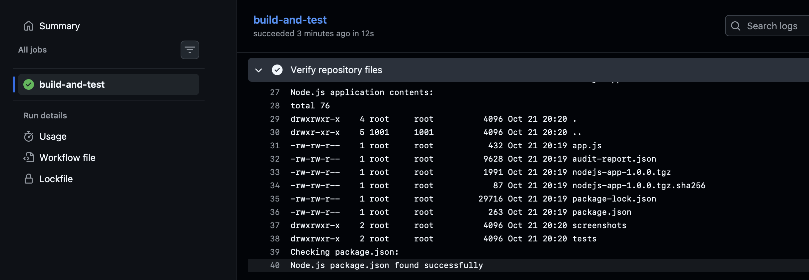
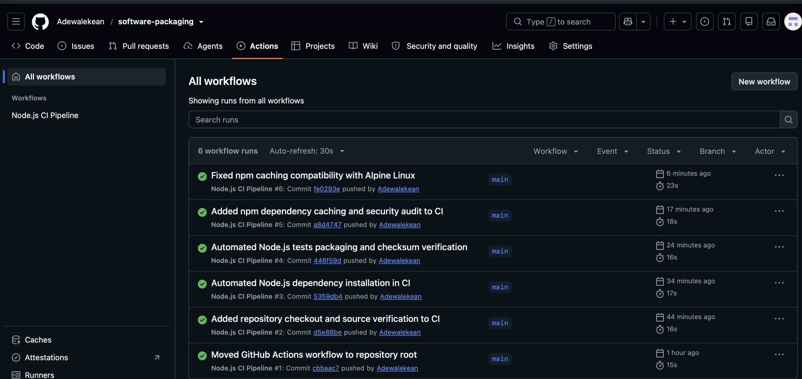

# Software Packaging in Popular Frameworks

## Project Overview

This project is about learning how to package applications in different programming frameworks so they can be tested and run in different environments.

I am working with Node.js, Django and Spring Boot to understand how dependencies, application versions, testing and security checks work.

## Project Structure

- `nodejs-app/` - Node.js application
- `django-app/` - Django application
- `springboot-app/` - Spring Boot application
- `staging/` - Temporary staging environment
- `CHANGELOG.md` - Record of project changes

## Node.js Application

I started by creating a simple Node.js application using Express.

The application displays a message when someone visits the homepage.

### Dependencies

I used npm to install Express and manage the application's dependencies.

I initially used Jest and Supertest for testing, but later replaced them with Node.js's built-in testing tools.

### Testing

I created two automated tests to check that:

1. The homepage returns HTTP status 200.
2. The homepage displays the correct message.

Both tests passed.

To run the tests:

```bash
cd nodejs-app
npm install
npm test
```

### Packaging

I set the application version to `1.0.0` and created an npm package using:

```bash
npm pack
```

This generated `nodejs-app-1.0.0.tgz`.

I also generated a SHA-256 checksum to check the integrity of the package.

To verify it:

```bash
shasum -a 256 -c nodejs-app-1.0.0.tgz.sha256
```

The checksum verification returned `OK`.

### Staging

I extracted the packaged application into a separate staging folder, installed the production dependencies and ran it using port 3001.

The application ran successfully in the staging environment.

### Security Audit

I ran `npm audit` to check for vulnerabilities.

The first audit reported 19 moderate vulnerabilities linked to development dependencies used by Jest.

I investigated the dependency chain and tried a compatible update, but the vulnerabilities remained.

Instead of forcing a potentially breaking downgrade, I replaced Jest and Supertest with Node.js's built-in testing tools.

After removing the unnecessary dependencies, I ran the tests and security audit again.

**Final results:**
- 2 automated tests passed.
- 0 vulnerabilities reported by npm audit.
- Updated package rebuilt successfully.
- SHA-256 checksum verified successfully.

## Django Application

To be completed.

## Spring Boot Application

To be completed.

## What I Learned

So far, this project has helped me understand how to manage application dependencies, create packages, run automated tests and investigate security vulnerabilities.

I also learned that removing unnecessary dependencies can reduce security risks and make an application easier to maintain.

## GitHub Actions CI Pipeline

### Project Overview

For this task, I used GitHub Actions to automate the testing and packaging of my Node.js application.

Instead of running everything manually each time I make changes, I created a workflow that installs the dependencies, checks for security vulnerabilities, runs the tests, packages the application and verifies its checksum.

I used Alpine Linux as the container environment for the pipeline.

### Workflow Configuration

I created the workflow file at:

`.github/workflows/ci.yml`

The workflow runs automatically when I push changes to the `main` branch or create a pull request targeting `main`.

I used GitHub's `ubuntu-latest` runner with a `node:22-alpine` container. This allowed the workflow commands to run inside an Alpine Linux environment.

Since the repository contains more than one application, I set the working directory to `nodejs-app`.

### Repository Checkout

I used `actions/checkout@v4` to download the repository files into the runner.

I also added a step to check that `package.json` and `package-lock.json` were available before installing dependencies.



### Dependency Installation

I used `npm ci` to install the Node.js dependencies from `package-lock.json`.

I chose `npm ci` because it is suitable for automated builds and helps keep dependency installation consistent.

I also used `npm ls --depth=0` to check the installed dependencies.

### Automated Testing

I added `npm test` to the workflow.

The application has two tests:

1. Check that the homepage returns HTTP status 200.
2. Check that the homepage displays the expected message.

Both tests passed in GitHub Actions.



### Security Audit

I added a security check using:

```bash
npm audit --omit=dev --audit-level=high
```

This checks production dependencies and makes the workflow fail if npm reports vulnerabilities at the high or critical severity level.

The security audit completed successfully.



### Dependency Caching

I used `actions/cache@v4` to cache npm dependencies.

The cache key is based on the `package-lock.json` file, so GitHub Actions can reuse the cache when the dependencies have not changed.

I initially had problems saving the cache because Alpine Linux uses BusyBox `tar`, which did not support an option required by the caching action.

I fixed the issue by installing GNU tar:

```bash
apk add --no-cache tar
```

After making the change, the cache was saved successfully. I ran the workflow again and confirmed that the cache was restored.



### Packaging and Checksum Verification

After the tests passed, the workflow created an npm package using:

```bash
npm pack
```

This generated `nodejs-app-1.0.0.tgz`.

The workflow then generated a SHA-256 checksum and verified the package using `sha256sum`.

The verification returned `OK`.



### Uploading the Build Artifact

I used `actions/upload-artifact@v4` to upload the packaged application and its checksum file.

The artifact is named `nodejs-app-package` and can be downloaded from a completed GitHub Actions run.



### Troubleshooting

I encountered two main problems while setting up the pipeline.

**1. Workflow not appearing in GitHub Actions**

I initially created the workflow inside the `nodejs-app` directory.

GitHub did not recognize it because the workflow file needed to be inside `.github/workflows/` at the root of the repository.

I moved the file to the correct location, committed the change and pushed it to GitHub. The workflow then appeared and ran successfully.

**2. npm cache failing on Alpine Linux**

The workflow was completing, but the cache was not being saved.

I checked the post-job logs and found this error:

```text
/bin/tar: unrecognized option: posix
```

The problem was caused by Alpine Linux's default BusyBox `tar`.

I installed GNU tar before the caching step and ran the workflow again. The cache was saved successfully, and I confirmed that it could be restored on another run.

### Final Pipeline Result

The workflow completed successfully with:

- Automated dependency installation.
- Two passing tests.
- Successful production dependency security audit.
- npm dependency caching.
- Application packaging.
- SHA-256 checksum verification.
- Build artifact upload.



### What I Learned from GitHub Actions

This task helped me understand how to automate application testing and packaging using GitHub Actions.

I learned how workflow triggers, runners, containers, caching and artifacts work.

I also learned how to use workflow logs to identify problems. The Alpine Linux caching issue was a good example because the pipeline was successful, but one of the post-job steps was still failing.

After fixing it, I was able to confirm that the cache worked properly.